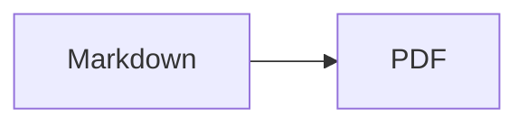

# md2pdf syntax reference

md2pdf reads CommonMark with the GitHub (GFM) extensions and adds the syntax
listed here. Everything works in both outputs, PDF and HTML, unless a section
says otherwise.

Two rules differ from most Markdown tools:

- Every newline in the source is a visible line break. A blank line starts a
  new paragraph. Set `breaks: false` in the frontmatter to make single
  newlines soft again.
- Raw HTML is mostly shown as text. Only a short list of formatting tags is
  honoured (see [Raw HTML](#raw-html)).

For a complete rendered example, see the `md2pdf://example` MCP resource or
[`tests/extended.md`](../tests/extended.md).

## Paragraphs and spacing

- A blank line starts a new paragraph.
- Three or more blank lines between two paragraphs leave extra vertical space.
- A line holding only `\` (after a blank line) is an empty paragraph.
- A `\` at the end of a line is a hard line break, as in CommonMark.
- `---` on its own line is a horizontal rule.

## Inline formatting

| Syntax | Result |
|---|---|
| `**bold**` | bold |
| `*italic*` or `_italic_` | italic |
| `__underline__` | underline (not bold) |
| `++inserted++` | underline |
| `~~strike~~` | strikethrough |
| `==highlight==` | highlighted text |
| `^sup^` | superscript, only if the content has no spaces |
| `~sub~` | subscript, only if the content has no spaces |
| `` `code` `` | inline code |
| `\*` | a literal `*` (any punctuation can be escaped) |

`2^10 and 3^4` and `~5 to ~10` stay as written, because the text between the
markers contains spaces. `19^th^` and `H~2~O` are formatted.

Links, reference links, `<https://…>` and bare URLs work as in GFM. Links may
use `http`, `https`, `mailto`, `tel` or `ftp`, or point inside the document.
A link with any other scheme
keeps its text and loses the link.

Emoji characters and `:shortcodes:` (`:smile:`, `:rocket:`) render as Twemoji
images. A sequence with no Twemoji file stays text.

## Footnotes

```markdown
Text with a note[^1] and an inline note^[Written in place.].

[^1]: The definition. It may hold **Markdown**.
```

Footnotes are numbered in order of use, in both outputs.

## Raw HTML

- HTML comments (`<!-- … -->`) are dropped.
- These tags render as formatting, with any attributes ignored:
  `<b>` `<strong>` `<i>` `<em>` `<u>` `<ins>` `<s>` `<del>` `<strike>`
  `<sub>` `<sup>` `<kbd>` `<mark>` `<small>` `<br>`.
- Every other tag stays visible as text.

`<br>` is the way to break a line inside a table cell.

## Headings and anchors

`#` to `######` make headings. Every body heading gets an ID built from its
text, Unicode included. Link to `## My Section` with `[jump](#my-section)`.

Add a stable ID that is not printed:

```markdown
## My Section {#overview}

[jump](#overview)
```

An ID starts with a letter or digit, then uses letters, digits, `-`, `_`, `.`
or `:`. An invalid `{#…}` stays visible as text.

If the frontmatter has no `title`, a leading `#` heading becomes the document
title and is removed from the body, so it is not printed twice. That heading
is then not a link target.

## Lists

- `-`, `*` and `+` make bullet lists. Nesting works as usual.
- `1.` or `1)` make numbered lists. A list keeps its start number, so
  `57.` starts at 57.
- Lettered and roman lists: two or more items in sequence, after a blank
  line, using `a.`, `A.`, `i.` or `I.`.
- Task lists: `- [ ]` and `- [x]`. In the web app's Web preview, ticking a
  box edits the source. In the PDF and in exported HTML the boxes are
  static.

```markdown
a. first
b. second
c. third
```

## Tables

GFM tables, with `:` in the separator row for alignment. Append `+` to a
separator cell to widen its column: `---` is one share of the width, `---+`
two, `---++` three.

```markdown
| Narrow | Wide         |
| ------ | ----------++ |
| one    | three shares |
```

In the PDF a table can span pages, but a row is never split. Use `<br>` for a
line break inside a cell.

## Code blocks

Fence code with ` ``` ` or `~~~` and name the language after the opening
fence to highlight it. A fence without a language is plain preformatted text.
Indented code blocks work too.

Anything after the language is ignored: `js=101`, `{.python}` and
`title="x"` all highlight as the named language. In the PDF every code block
has line numbers in the gutter, starting at 1.

## Math

| Syntax | Result |
|---|---|
| `$x^2$` | inline math |
| `` $`x^2`$ `` | inline math, GitHub spelling |
| `$$ … $$` | display math, on its own lines |

The LaTeX is converted for Typst in the PDF and to MathML in HTML. amsmath
environments such as `aligned` work. A formula the PDF cannot typeset is shown
as its LaTeX source instead of failing the document.

````markdown
$$
\int_0^\infty e^{-x^2}\,dx = \frac{\sqrt{\pi}}{2}
$$
````

## Diagrams

A fence tagged `mermaid` renders as a diagram. Other diagram fences
(`sequence`, `flow`, `graphviz`, `plantuml`, `abc`, `vega` and so on) are shown
as code.

````markdown

````

## Images

The alt text becomes the caption. Leave it empty for an image without one.
Images are centred and, without a size, as wide as the text (change this with
`image-width` in the frontmatter).

| Syntax | Result |
|---|---|
| `` | full text width, alt as caption |
| `` | 320 wide, 200 tall |
| `` | 320 wide, height follows |
| `` | 120 tall, width follows |
| `` | same, angle-bracket form |
| `` | size after a title, Outline form |

HedgeDoc's form, without angle brackets, works too:

```markdown

```

Sizes are CSS pixels in both outputs; the PDF converts them at 0.75 pt per pixel.

The target may be a file next to the document or an `http(s)` URL. The host
(CLI or web app) fetches remote images with limits on size, time and address.
A remote image that cannot be fetched becomes a blank placeholder. A local
image that is missing renders as a placeholder too, and the document still
renders.

Wrap an image in `:::left`, `:::center` or `:::right` to move it.

## Callouts

```markdown
:::warning Optional title
Body with **Markdown**.
:::
```

The kinds are `info`, `note`, `tip`, `success`, `warning`, `caution`,
`danger` and `important`. Text after the kind replaces the default label.
Default labels follow `lang`: with `lang: de` they are German (`success` is
"Erfolg").

- `::: info` with a space after the colons works too.
- A fence of N colons closes on a line of N or more colons, so a longer fence
  can hold a shorter one.
- A `:::` block may be indented inside a list item or a blockquote.
- An opener without a closing line stays text.
- An unknown kind (`:::question`) is not a block and stays text.

## Layout blocks

- `:::left`, `:::center` and `:::right` align prose, headings, images,
  display math and diagrams. Tables and code blocks keep their own layout.
- `::::row` puts its top-level blocks (separated by blank lines) side by
  side in equal columns. Close it with `::::`. Use the longer fence when the
  row holds other `:::` blocks.

```markdown
::::row
:::tip
Left.
:::

:::warning
Right.
:::
::::
```

## Spoilers

A collapsible block. Open it with three or more `+` and close it with a line
of the same number of `+`. The text after the opener is the summary. Without
one, the first non-blank line inside becomes the summary.

```markdown
+++++ Click to reveal
Any **Markdown**.
+++++
```

A `++++` spoiler can hold a `+++` one. A fence of five or more `+` closes on
any line of five or more. HedgeDoc's form works too:

```markdown
:::spoiler Click to expand
Hidden content.
:::
```

## Structural tokens

| Token | Effect |
|---|---|
| `[toc]` (any case) | table of contents, titled by `lang` |
| `[[pagebreak]]` | new page in the PDF, a dashed line in HTML |

Each token must be a paragraph on its own.

## Embeds

A paragraph holding only one of these becomes a link:

| Syntax | Link to |
|---|---|
| `` | YouTube video |
| `` | Vimeo video |
| `` | GitHub Gist |
| `` | SlideShare |
| `` | Speaker Deck |
| `` | the PDF |

## Bylines

HedgeDoc bylines become one line of small grey text, here
"— Ada, Mon, Jan 1, 2024". A `color` tag is removed.

```markdown
> A quote.
> [name=Ada] [time=Mon, Jan 1, 2024] [color=red]
```

## Citations

Set `bibliography: inline` and end the document with BibTeX entries. Cite
them with `[@key]`. Group several with `[@a, @b]` or `[@a; @b]`.

```markdown
---
bibliography: inline
---

As shown in [@knuth].

@book{knuth,
  author = {Donald Knuth},
  title = {The TeXbook},
  year = {1984}
}
```

The reference list is added at the end, headed "References" ("Referenzen" for
`lang: de`). BibTeX inside a fenced code block stays ordinary content.

## YAML frontmatter

Put a YAML block at the very start of the file, between `---` and a closing
`---` or `...`. A leading `---` counts as frontmatter only when a YAML mapping
follows, so a document that starts with a rule still renders.

All keys are optional. Keys are case-insensitive, and `_` equals `-`
(`Header_Left` is `header-left`). `true`/`false` switches also accept
`yes`/`no` and `on`/`off`. Lengths are positive `pt`, `mm`, `cm` or `in`
values.

### Document

| Key | Value | Default |
|---|---|---|
| `title` | text | leading `#` heading |
| `subtitle` | text, HTML only (the PDF cover uses `cover-subtitle`) | none |
| `authors` or `author` | a name or a list | none |
| `date` | text | none |
| `lang` | `en`, `de`, `de-AT`, … | `en` |
| `breaks` | `false` makes single newlines soft | `true` |
| `image-width` | default width of unsized images, such as `85%` or `120mm` | `100%` |

`lang` sets hyphenation, quotes and built-in labels in the PDF (`[toc]` is
headed "Inhaltsverzeichnis" under `lang: de`). German callout labels apply to
any `de` variant.

### HTML only

| Key | Value | Default |
|---|---|---|
| `hide-toc-button` | `true` drops the outline button (an explicit `[toc]` stays) | `false` |
| `hide-theme-toggle` | `true` drops the light/dark toggle in exported HTML | `false` |

### Page numbers (PDF)

`page-numbers` (or `pageNumbers`) sets the default centre of the footer.

| Value | Footer centre |
|---|---|
| `true` or `"1"` (default) | `3` |
| `"1/1"` | `3 / 12` |
| `"Page {page} of {pages}"` | `Page 3 of 12` |
| `false`, `no` or `off` | nothing |

Setting `footer-center` replaces the page number.

### Header and footer (PDF)

| Key | Value |
|---|---|
| `header-left`, `header-center`, `header-right` | text, links or an image |
| `footer-left`, `footer-center`, `footer-right` | text, links or an image |
| `header-height`, `footer-height` | a length that reserves room for the slot |

Slots are small and grey. They appear from page 2 when the document has a
cover, and from page 1 when it has none. Placeholders work in every slot and in
a `page-numbers` template:

| Placeholder | Expands to |
|---|---|
| `{page}`, `{pages}` | current page, total pages |
| `{title}` | `title` |
| `{subtitle}` | `cover-subtitle` |
| `{author}`, `{authors}` | the authors, comma-separated |
| `{date}` | `date` |

An unknown placeholder is left as written. A slot may hold `[text](url)`
links (`http`, `https`, `mailto`), an image, or a linked image:

```yaml
header-left: "[Project site](https://example.org) · {title}"
header-right: "[](https://example.org)"
footer-left: ""
```

Image sizes in slots are CSS pixels too. `=x22` sets the height only. A remote
`https://` image works there too. Content taller than a set
`header-height`/`footer-height` stops the PDF build instead of overlapping the
body.

### Cover page (PDF)

| Key | Value | Default |
|---|---|---|
| `cover` | `arcs`, `strata`, `wedge`, `grid`, `true` (= `arcs`) or `false` | off |
| `cover-color` | `ocean`, `ink`, `ember`, `plum`, `forest`, `crimson`, `teal`, `gold`, `rub`, or a hex value | `ocean` |
| `cover-subtitle` | text | none |
| `cover-logo` | an image, placed top right | none |
| `cover-date` | text | `date` |
| `cover-image` | an image that fills the whole cover | none |
| `cover-text-color` | `white`, `black` or a hex value | `black` |

The cover is page 1, so the first content page is page 2. Title, subtitle,
authors and date move onto the cover. `cover-image` turns the cover on by
itself and replaces the geometry. It always fills the A4 page, cropped if
needed. PDF files cannot be used as a cover image.

### Letter mode (PDF)

Any `letter-*` key switches the first page to a DIN 5008 form B letter layout.
Letter mode turns the cover off.

| Key | Value |
|---|---|
| `letter-return` | one line, the small return-address line |
| `letter-to` | one line or a list, up to six lines |
| `letter-from` | one line or a list, sender block on the right |
| `letter-subject` | text |
| `letter-date` | text, such as `"Berlin, 17.05.2026"` |

### Citations

| Key | Value | Default |
|---|---|---|
| `bibliography` | `inline` enables trailing BibTeX | off |
| `bibliography-style` | a Typst bibliography style; an unknown name falls back to `ieee` | `ieee` |
| `bibliography-title` | heading of the reference list, `false` for none | "References" |

### Example

```yaml
---
title: Quarterly Report
authors: [Ada Lovelace, Alan Turing]
date: 2026-05-19
lang: en
page-numbers: "1/1"
header-left: "{title}"
header-right: "{date}"
cover: arcs
cover-color: "#0074de"
cover-subtitle: Second quarter
image-width: 80%
---
```

## HedgeDoc and Outline

Markdown copied from HedgeDoc or exported from Outline ("Copy as Markdown")
renders without changes. The syntax above that comes from these tools:

- HedgeDoc: `++inserted++`, `^sup^`, `~sub~`, `==mark==`, `:::spoiler`,
  bylines, `` embeds, `=WxH` image sizes, `js=101` fence flags, `[TOC]`.
- Outline: `:::info`/`:::warning`/`:::tip`/`:::success` notices, `+++`
  toggles that nest, `\` empty paragraphs, `"Caption =WxH"` image sizes.
  Attachment links lose the byte count Outline appends to their label.

HedgeDoc frontmatter keys md2pdf does not know (`tags`, `robots`,
`opengraph`, …) are ignored. Font Awesome icons (`<i class="fa …">`) render
as nothing, since the tag becomes empty italics.
