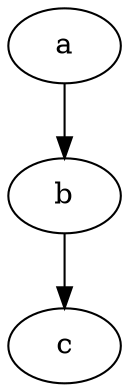
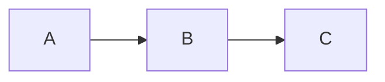
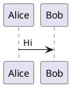

# Sample Field Notes

## Table of contents

[TOC]

## Inline formatting

**bold** and __also bold__, *italic* and _also italic_, ~~deleted~~.

Superscript: 19^th^ and subscript: H~2~O.

++Inserted text++ and ==marked text==.

Inline footnote^[Text of an inline footnote] and a named one[^first] and again[^first].

[^first]: Footnote **with markup**
    and a second line.

Emoji: :smile: :tada: :fire:

Icons: <i class="fa fa-eye fa-fw"></i> View, <i class="fa fa-pencil"></i> Edit.

## Extra tags in blockquotes

> A quote with a byline.
> [name=Alex Example] [time=Sun, Jun 28, 2015 9:59 PM] [color=#907bf7]
> > A nested quote.
> > [name=Sam Sample] [time=Sun, Jun 28, 2015 9:47 PM] [color=red]

Free-standing tags: [name=Alex Example] and [time=Mon, Jan 1, 2024 10:00 AM] and [color=blue].

## Alert containers

:::success
Success message :tada:
:::

:::info
Info message
:::

:::warning
Warning message
:::

:::danger
Danger message
:::

:::spoiler Click to expand
Hidden **content** with a list:

- one
- two
:::

## Code blocks

```javascript=
var s = "line numbers";
alert(s);
```

```javascript=101
var s = "start at 101";
alert(s);
```

```javascript=+
var s = "continue numbering";
```

```!
A long line without breaks that should wrap instead of scrolling horizontally when rendered in the editor view.
```

``` markdown
# fence with a space before the language
```

```js
console.log("plain js");
```

    indented code block
    second line

## Diagram fences

```sequence
Alice->Bob: Hello Bob
Note right of Bob: Bob thinks
Bob-->Alice: Fine
```

```flow
st=>start: Start
e=>end: End
op=>operation: Step
st->op->e
```





```abc
X:1
T:Tune
M:4/4
K:G
|:GABc dedB|dedB dedB:|
```

```vega
{"$schema":"https://vega.github.io/schema/vega-lite/v5.json","data":{"values":[{"a":1,"b":2}]},"mark":"bar","encoding":{"x":{"field":"a","type":"ordinal"},"y":{"field":"b","type":"quantitative"}}}
```



```csv
name,value
alpha,1
beta,2
```

## Externals













## Math

Inline: $e^{i\pi} + 1 = 0$ in a sentence.

Block:

$$
x = {-b \pm \sqrt{b^2-4ac} \over 2a}
$$

* List item with display math
$$
y = \frac{a}{b}
$$

## Typography

(c) (r) (tm) +- test... "double quotes" 'single quotes' a---b 1980--1988

___

---

***

## Lists and tasks

+ plus item
  - nested dash
    * nested star
+ another

57. offset start
1. next

- [ ] open task
  - [x] done subtask
- [x] done task

## Definition lists

Term 1

:   Definition 1
with lazy continuation.

Term 2 with *inline markup*

:   Definition 2

*Compact style:*

Term A
  ~ Definition A1
  ~ Definition A2

## Abbreviations

This is an HTML abbreviation example.

*[HTML]: Hyper Text Markup Language

## Tables

| Left | Center | Right |
|:-----|:------:|------:|
| a    |   b    |     c |
| <span class="text-nowrap"><i class="fa fa-leaf"></i> **Raw HTML**</span> | x | y |

## Links and images

[link](https://example.com) [with title](https://example.com "title text") <https://example.com/auto>


![Ref style][ref]

[ref]: https://example.invalid/ref.png  "Ref Title"


## Raw HTML and comments

<details>
<summary>Native details</summary>

Body of details.

</details>

<div align="center">centered div</div>

<!-- an HTML comment -->

<center>deprecated center tag</center>

<kbd>Ctrl</kbd>+<kbd>C</kbd>, <sup>sup</sup>, <sub>sub</sub>, <u>underline</u>, <mark>mark</mark>

## Hard breaks

Line one with two trailing spaces  
line two after the break
line three on a soft break
